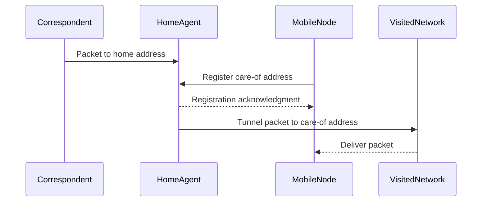

# CO3: Wireless Mobility, Mobile IP and Ad Hoc Routing
**Student:** B. Vinay Kumar | **Register number:** 192373042 | **Institution:** SIMATS Engineering

## Purpose and scope
This report supports the CO3 assignment themes in the supplied Assignment 3 PDF. It uses original explanations and reproducible **model outputs**, not claims of measured radio performance. The submitted PDF in `CO3/MC ASSIGNMENT 3.pdf` remains the report reference.

## Q1. Wireless architecture and handoff
A mobile node (MN) accesses an application server through an access point (AP), gateway and IP network. When the MN moves, signal conditions change. A connection manager chooses whether to stay or change attachment. A handoff can interrupt packets while association and routing state are updated. Use hysteresis to avoid switching when the candidate AP is only marginally better.


In the sample trace, AP1 signal weakens while AP2 strengthens. The decision model switches only when AP2 exceeds AP1 by the configured margin; this is a **policy simulation** and not a measurement of actual roaming.

## Q2. Mobile IP and location management
In traditional Mobile IPv4, the Mobile Node has a stable home address and obtains a care-of address (CoA) when visiting another network. The Home Agent maintains a binding from home address to CoA; packets can be tunneled toward that CoA. Registration delay, triangulated routing, tunneling overhead and packet loss are design costs.



A duplicate or stale registration must not silently replace a newer binding; the experimental registry uses monotonically increasing sequence numbers as an illustrative safeguard, not a complete Mobile IP implementation.

## Q3. Cellular versus ad hoc networks
Cellular networking uses managed infrastructure, base stations and centralized mobility support. Mobile ad hoc networking (MANET) forms links among peer nodes and may require multi-hop paths. Cellular service often improves manageability and reach, whereas a MANET can operate in an infrastructure-less emergency area but must handle route churn and resource-constrained relays.

## Q4. Routing fundamentals
A routing algorithm chooses a next hop or path subject to topology and policy. Link failure can invalidate an existing route; a protocol may periodically maintain routes or discover a new path when needed.

## Q5. DSDV (proactive)
Destination-Sequenced Distance Vector routing keeps a table of destination, next hop, hop count and sequence number. Routes with fresher destination sequence numbers are preferred; with equal sequence numbers, a lower metric can be selected. Keeping routes proactively reduces initial request delay but increases update traffic.

## Q6. AODV (reactive)
Ad hoc On-demand Distance Vector routing discovers routes when needed using route requests (RREQ) and replies (RREP). A broken link may trigger an error and renewed discovery. The Python graph demonstration performs an on-demand breadth-first search; it **does not implement full RFC AODV timers, sequence numbers or broadcast control traffic**.

## Q7. Emergency network evaluation
For an emergency network, the key criteria are reachability, hop count, path alternatives, control overhead, packet delivery ratio and recovery delay. A short route may be fragile; an alternate path can improve resilience. The experimental model checks whether changing links affects path availability; no physical network packets are transmitted.

## Run the original CO3 model
```powershell
python CO3/CO3_Assignment_3/experiments.py
python -m unittest discover -s CO3/CO3_Assignment_3 -p "test_*.py" -v
```
The existing `simulations.py` is preserved. Results generated by `experiments.py` are labeled illustrative.

## References
- IETF RFC 3344, IP Mobility Support for IPv4: https://www.rfc-editor.org/rfc/rfc3344
- IETF RFC 3561, Ad hoc On-Demand Distance Vector Routing: https://www.rfc-editor.org/rfc/rfc3561
- Perkins and Bhagwat, Highly Dynamic Destination-Sequenced Distance-Vector Routing for Mobile Computers (1994)
