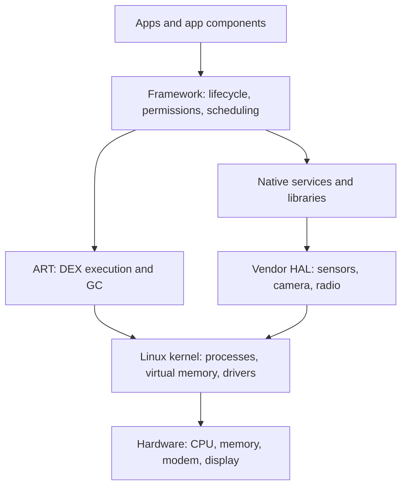
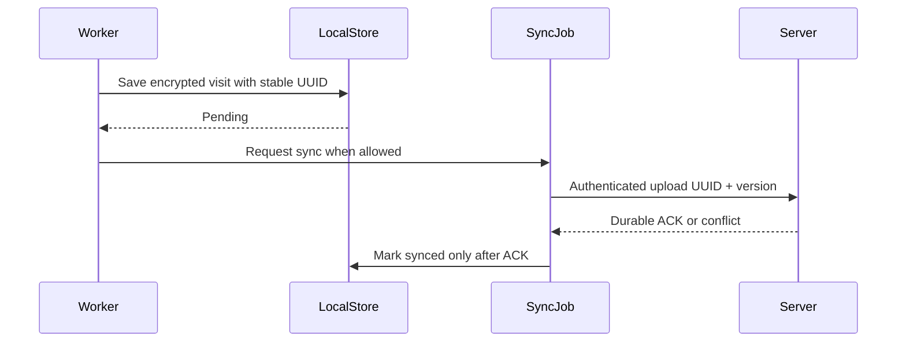

# CO4: Mobile Operating Systems, Architecture, Runtime, Security and Power

**Student:** B. Student | **Register number:** 

This original companion explains the six design tasks in the attached *ITA03-MP Assignment 4, Part I* (a 55-page design-only assignment). Existing Part I DOC/DOCX files in this CO4 folder are preserved. **Part I is a written architecture exercise; the Python model below is separately labeled supplemental practice, not evidence that an IDE or SDK was used to complete Part I.**

## Task 1 – Diagnose and repair an architecture
A six-line description such as "kernel runs the applications" is underspecified. A useful specification identifies each layer, owner, interface, and lower dependency.



The kernel schedules processes and threads, but application lifecycle policy resides in higher-level system services. Security is layered across package signing, permissions, UID separation and mandatory access control. Battery management combines application policy, OS job deferral and kernel power mechanisms.

## Task 2 – Compare Android, iOS and Windows for background delivery
Requirements: private data, a bounded amount of energy, durable messages, and recovery after disconnection. Android can integrate FCM and an OS-managed worker; iOS uses APNs with OS-managed background constraints; Windows options depend on the Windows app model. The key principle is **server-side persistence plus an idempotent fetch**, rather than assuming push always wakes a terminated application.

## Task 3 – From install package to interactive process
Android distributes an APK/AAB-derived install, DEX, resources and optional native libraries. A cold launch may fork an app process from Zygote, initialize ART/application state and display the first frame. ART uses interpretation and compilation strategies; an existing process may allow a warm launch. iOS runs signed native apps and Windows uses native or managed runtimes depending on its application model. Record actual launch times with Android instrumentation rather than inferring them from theory.

## Task 4 – SecureNotes security forensics
Potential faults: dangerous permission requested without need, exported components accepting unchecked intents, plaintext token storage, insecure transport and logging secrets. Fixes: least-privilege permissions, private components, app-side and server-side input validation, secure credential storage, strict HTTPS validation, and deny-by-default behavior on permission refusal. Signing does not replace server authentication or encryption.

## Task 5 – Power state reasoning
App conditions are active interaction, background idle, low battery, offline and charging. Sample sensor data only when required, defer nonurgent uploads, and use OS-managed scheduling. A foreground service is not a universal exemption from restrictions. A low battery threshold is **a chosen application parameter**, not a universal Android constant.

## Task 6 – RuralCare architecture
Class A modern smartphones can run offline-first Android/iOS clients. Data entry should persist to a protected local outbox with stable record UUID, version, timestamp and sync state. A constrained legacy Class C device should send minimum necessary data via secure available channels; if secure storage is absent, avoid confidential offline patient caches.



Failure test: server accepts a record but ACK is lost. The retry uses the same UUID and server deduplication, preventing a duplicate encounter.

## Practical companion (separate from design-only Part I)
```powershell
python CO4/CO4_Assignment_4/practical_model.py
python -m unittest discover -s CO4/CO4_Assignment_4 -p "test_*.py" -v
```

The scripts are logic-level simulations, not Android ART, Doze or battery instrumentation. See `EVIDENCE.md` for genuine Android evidence steps.

## References
- https://developer.android.com/guide/platform
- https://source.android.com/docs/core/runtime
- https://developer.android.com/develop/background-work/background-tasks
- https://developer.android.com/guide/topics/permissions/overview
- https://developer.android.com/training/monitoring-device-state/doze-standby
