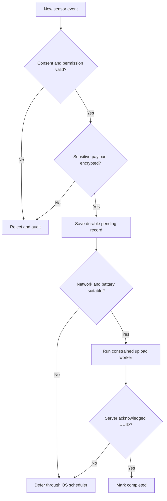

# CO5: Constraint-aware Mobile Application Design and Experiments
**Student:** B. Vinay Kumar | **Register number:** 192373042 | **Institution:** SIMATS Engineering

The uploaded CO5 assignment describes **Part A (design)** and **Part B (computational investigation)**. This is an original supporting report adapted to the same learning outcomes. It does not copy the other student's assignment or purport to have measured an Android device.

## Part A – Design, analysis and architectural reasoning

### A1. Intent and background work
A sensor observation has an owner, creation time, consent status, priority and privacy requirements. The app first stores an authorized sample in protected local storage, then decides whether transmission is permitted. An urgent user-visible event may follow a separately allowed notification route, but urgency never overrides user consent or encryption requirements.



Use explicit intents for known internal components and carefully resolve implicit intents before dispatch to another application. Persistent sync tasks should use WorkManager where appropriate; ongoing foreground services must meet platform-specific rules.

### A2. Safe incremental synchronization
Scanning and uploading an entire database on every launch wastes network and CPU. Maintain pending records, stable UUIDs, changed-since cursors, version numbers and bounded batches. Reject records that violate encryption or consent rules; defer valid but temporarily unsendable records. A missing ACK must not cause a duplicate server-side record.

### A3. Common scheduler pattern
Sensor capture, upload and notifications all follow event → candidate action → precondition checks → execute or defer → acknowledgement → cleanup/retry. On logout, revoke account credentials, cancel old-session workers and prevent new transmissions for the stale identity.

### A4. Local versus cloud processing
Local processing improves offline functionality and may reduce exposure but is limited by memory and energy. Cloud inference offers larger models but requires network access and privacy safeguards. A hybrid design can cache bounded local summaries and send only authorized data for heavier processing.

### A5. UI performance and approximation
A feed should never perform expensive ranking directly on the UI thread. Use a bounded candidate set, prepare ranking on a background dispatcher, paginate results and use image thumbnails. Approximate candidate filtering can trade a little ranking accuracy for predictable response time; measure both instead of assuming one is better.

## Part B – Implementation and computational investigation

### B1. Background scheduler
The Python `experiments.py` models a small work queue under permission, encryption, battery and connectivity checks. It is **not an Android WorkManager implementation**.

### B2. Adversarial workload
Test offline, low battery, revoked consent, unencrypted sensitive data and duplicate work IDs. Unsafe items must never execute; valid deferred items remain pending.

### B3. Exact versus approximate UI ranking
Compare scores for all items against a fixed-size candidate subset. The toy experiment reports operation counts, not real screen frame timing.

### B4. Multimedia adaptation
Select low, medium or high bitrate from a simulated bandwidth estimate. Actual adaptive-streaming playback, hardware decoding and buffering need media-framework instrumentation.

## Run
```powershell
python CO5/CO5_Assignment_5/experiments.py
python -m unittest discover -s CO5/CO5_Assignment_5 -p "test_*.py" -v
```

The existing `adaptive_service.py` is kept. Run the code and capture actual output before presenting a result as executed.

## References
- Android Developers, WorkManager: https://developer.android.com/topic/libraries/architecture/workmanager
- Android Developers, Background tasks: https://developer.android.com/develop/background-work/background-tasks
- Android Developers, Intent filters: https://developer.android.com/guide/components/intents-filters
- Android Developers, Performance: https://developer.android.com/topic/performance
- OWASP Mobile Application Security: https://mas.owasp.org/
