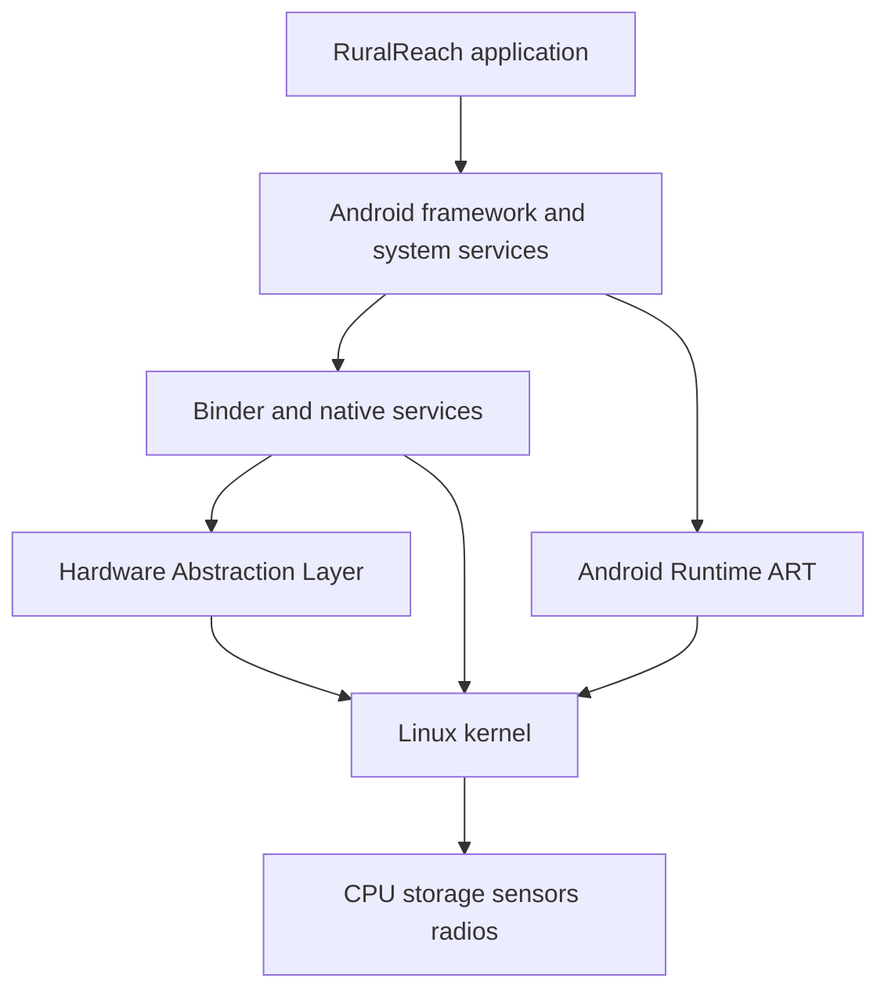
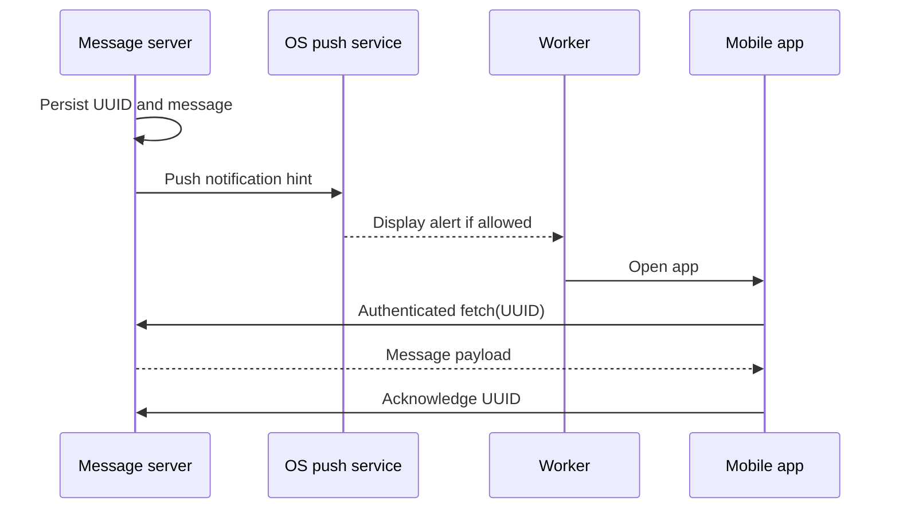
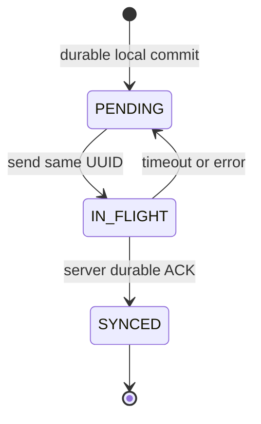
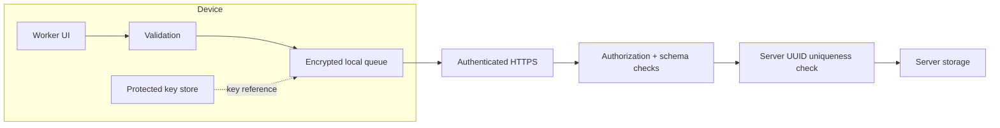
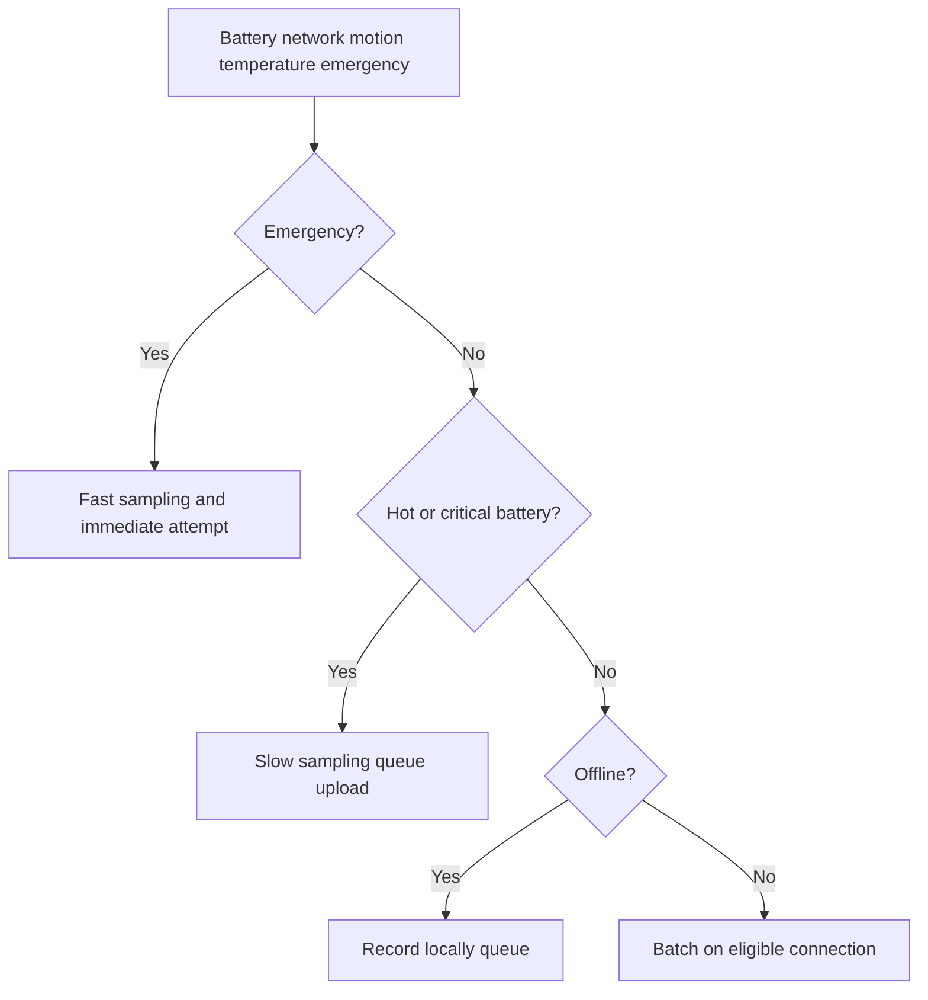

# Original design diagrams (Mermaid)

The following diagrams are conceptual; they do not assert observed operating-system behavior.

## 1. Mobile layered architecture

## 2. Notification and acknowledgement

## 3. Offline sync status machine

## 4. Trust and key boundary

## 5. Adaptive energy policy

