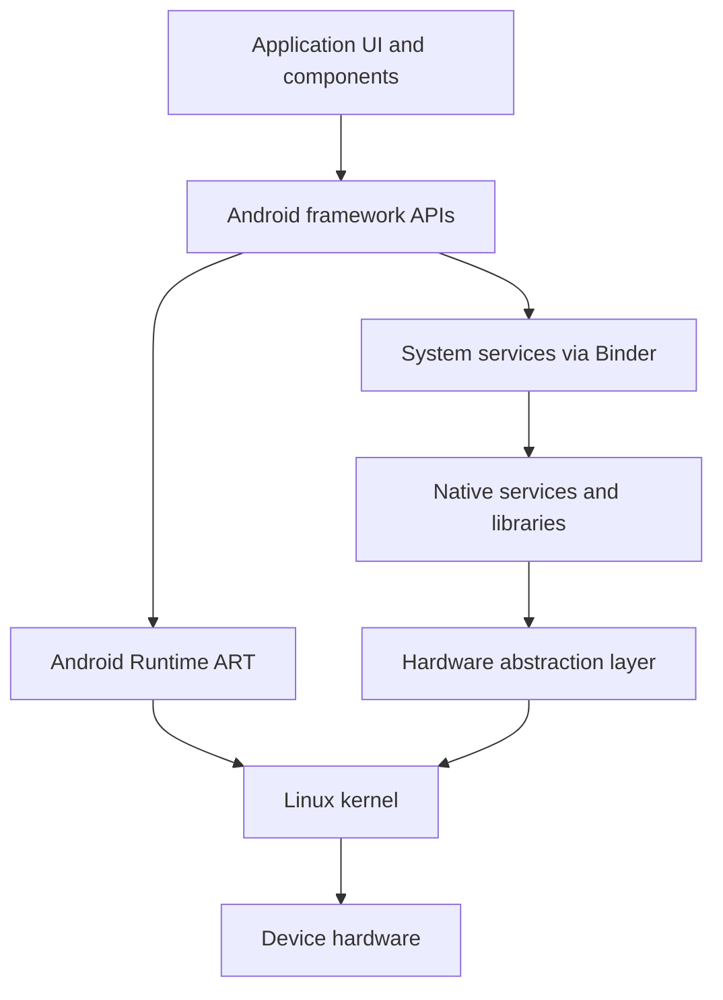
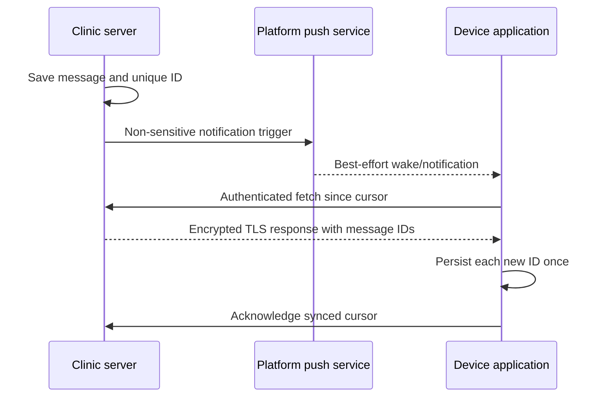
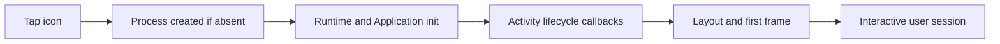
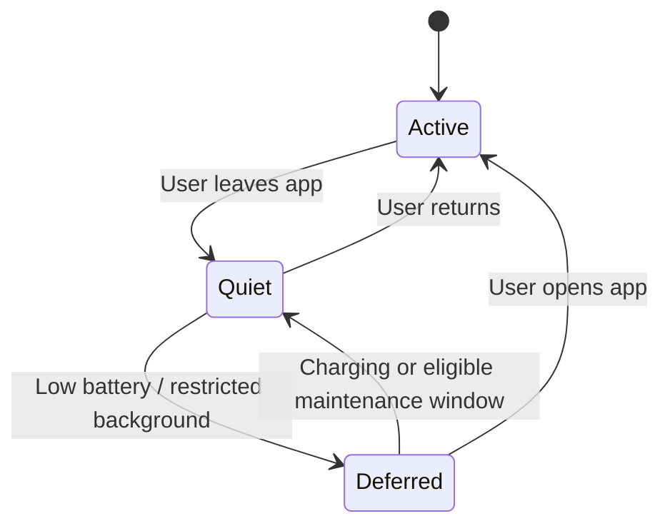
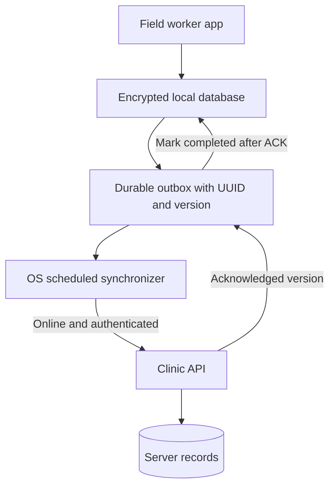

# Part I: Mobile Application Development Environment (CO4)
**Vinay Kumar | 192373042 | SIMATS**

**Method:** Design and analysis only. This part does not claim use of an IDE, SDK, emulator or physical-device measurements.

## Task 1 – Mobile operating system architecture

A mobile operating system serves as the boundary between application logic and processors, sensors, storage and radios. Its architecture determines how applications share resources without compromising one another's data. Android, iOS, and Windows differ in application models and runtime contracts, although all must provide isolation, scheduling, networking, graphics and power management.

### Android stack (conceptual model)

The top application layer contains activities, services, broadcast receivers and content providers. Framework APIs expose window, location, notification, package and activity management. ART executes DEX application bytecode using interpretation and compilation techniques, while native libraries supply graphics, database, crypto and multimedia functionality. Vendor implementations of hardware-facing services are isolated by the HAL. Under these layers, the Linux kernel supplies processes, memory management, drivers, networking, filesystem interfaces, and enforcement foundations.

**Example:** A clinic appointment app asks Android's location APIs for nearby clinics. The app does not address GPS hardware registers directly. Framework permissions, services, HAL and kernel drivers mediate the operation.

### Comparison

| Dimension | Android | iOS | Windows mobile/desktop-family model |
|---|---|---|---|
| Kernel foundation | Linux | XNU/Darwin | Windows NT |
| App delivery | Signed Android packages | Signed app bundles | Package/process model depends on Windows version |
| Primary application languages | Kotlin/Java, native C/C++ | Swift/Objective-C, native C/C++ | C#/C++ among others |
| Isolation | UID sandbox, SELinux, permissions | Sandbox, entitlements, code signing | Tokens, app containers where applicable |
| Runtime | ART for managed Android code | Native executable/runtime frameworks | Native Win32/WinRT and optional CLR for .NET |
| Power control | Doze, standby buckets, JobScheduler | Background execution policy, BGTaskScheduler | Power management varies by Windows platform |

**Architecture tradeoff:** A portable web UI can reduce development effort, but background tasks, device APIs, permission flows, and low-power behavior must still follow each platform's policy.

## Task 2 – Secure background message delivery

**Problem:** Deliver an urgent but confidential clinic follow-up alert when the app is minimized, the radio is unreliable, and the OS restricts background execution.

A permanent polling loop is a poor default: it consumes battery, may be throttled, and is killed when the OS reclaims processes. Instead, send a small **non-sensitive push trigger** through the operating system's push channel, then obtain the actual content from the application server after authentication. Android commonly uses Firebase Cloud Messaging; iOS uses Apple Push Notification service. Neither push delivery nor timing should be treated as guaranteed.

**Failures and recoveries:** If connectivity is absent, the server retains the message. If the device gets the same notification twice, the client checks message IDs to suppress duplicates. Expired credentials trigger re-authentication. For urgent clinical communications, delivery escalation must rely on an approved clinical workflow rather than assuming push notifications are safety-critical transport.

**Decision:** Favor system-managed delivery over long-running app services. Treat network delivery as at-least-once and make local storage idempotent.

## Task 3 – Runtime, lifecycle and startup

Android packages include DEX, resources, manifests, and optionally native code. During a cold launch, Android may create a process via Zygote and arrange initialization of ART, app components, and the first rendered activity. ART verifies and executes DEX using interpreter, just-in-time and profile-guided ahead-of-time compilation as appropriate. Garbage collection reclaims managed heap objects.

- **Cold start:** Process is absent; OS and application initialization cost is higher.
- **Warm start:** The process exists but the activity may need to be recreated or brought forward.
- **Hot start:** An existing activity resumes with comparatively little initialization.
- **Process death:** The OS can remove a background app; persistent data and saved state, not memory alone, must restore important work.

**Platform contrast:** iOS loads signed native binaries with its native runtime and automatic reference counting used for Swift/Objective-C object management. Windows has more than one application model; WinRT is a platform API architecture rather than an Android-style bytecode machine.

**Optimization:** Defer nonessential network and expensive database work until after first render, avoid blocking the UI thread, and measure actual startup with a platform profiling tool before asserting improvement.

## Task 4 – Mobile security review

**Scenario:** A volunteer health-worker app records visits, contact details and appointment status. Threats include a stolen phone, excessive permissions, interception of requests, exported components and outdated dependency code.

| Risk | Possible impact | Mitigation | Verification |
|---|---|---|---|
| Contact permission at install | Unexpected disclosure | Ask on demand, handle denial | Test grant and denial paths |
| Tokens in plaintext preferences | Account takeover on compromised device | Keystore-backed secrets; short-lived credentials | Inspect storage and logs |
| Unencrypted traffic | Interception or modification | HTTPS with certificate validation | Verify network security config |
| Unprotected exported activity | Untrusted intent may enter app | Non-exported by default, validate inputs | Inspect manifest and exercise intents |
| Lost device | Exposure of cached records | Encrypted local store, lock timeout, revocation | Test logout/revocation |
| Hard-coded credentials | Secret leaks through source | Environment configuration/secret manager | Scan repository for secrets |

Security is layered: Android signing checks package identity on updates, app sandboxing isolates ordinary processes, and runtime permissions mediate sensitive access. App logic must still authorize every server request, validate inputs, and avoid exposing personal data in logs.

**Privacy principle:** Store the minimum necessary health-related information, establish access roles, and never place patient details in push payloads or public test evidence.

## Task 5 – Battery-aware scheduling policy

Battery life depends on wake frequency, radios, CPU, screen, sensors and app background restrictions. The application should use OS-managed scheduled work instead of an unconditional wake lock.

| Application state | Location sampling | Non-urgent sync | User-visible result |
|---|---|---|---|
| Active, battery >= 20% | Only while workflow needs it | Short scheduled batches | Responsive data entry |
| Quiet, battery >= 20% | Off unless justified | Opportunistic sync | No persistent polling |
| Low battery below 20% | Reduced or off | Defer large uploads | Warn if pending updates |
| Offline | Off unless workflow requires | Queue encrypted records | Show offline status |
| Charging and connected | Normal workflow limits | Drain pending queue | Show updated sync state |

The table describes **an application policy**, not Android's internal Doze state transitions. Actual job execution is governed by OS versions, battery optimizations, quotas and device conditions. Never claim that a simulated state machine measures joules or real battery drain.

## Task 6 – Offline-first rural clinic workflow

**Need:** Field workers may record basic patient encounters in locations with intermittent connectivity. A usable system cannot require a successful internet call before showing each screen.

### Proposed design

1. The worker authenticates and opens an assigned patient record in a restricted local cache.
2. A new visit is saved locally with a UUID, update version, timestamp and status `pending`.
3. The app queues the same record UUID for server synchronization; it does not create a new ID on retries.
4. When online, a scheduled worker sends pending operations through authenticated TLS.
5. The server validates role and schema, deduplicates by UUID and version, writes transactionally, then returns an acknowledgement.
6. Only a durable acknowledgement changes local status to `synced`; failures remain retryable.
7. Concurrent edits produce a conflict state requiring a specified merge rule or authorized review.

**Example failure:** A POST reaches the server, but the acknowledgement is lost. On retry, the identical UUID causes the server to return the existing server version instead of duplicating the visit.

**Legacy device option:** A very constrained feature-phone workflow can use secure minimal server-side forms where available. Do not cache identifiable clinical information on a device that cannot protect it appropriately.

**Nonfunctional requirements:** Accessibility, small transfers, local encryption, schema migration, expiring sessions, sync transparency, audit logs and explicit data-retention policy.

## Study outcomes

This design demonstrates that mobile computing decisions need to balance portability, lifecycle management, secure data handling, battery cost and network resilience. The main architectural finding is to delegate background execution to the operating system while preserving durable, independently retryable data operations.

## References

1. Android Developers, *Platform architecture*: https://developer.android.com/guide/platform
2. Android Developers, *App startup time*: https://developer.android.com/topic/performance/vitals/launch-time
3. Android Developers, *Background work / WorkManager*: https://developer.android.com/develop/background-work/background-tasks
4. Android Developers, *Doze and App Standby*: https://developer.android.com/training/monitoring-device-state/doze-standby
5. Android Developers, *Permissions overview*: https://developer.android.com/guide/topics/permissions/overview
6. Android Open Source Project, *Android Runtime (ART)*: https://source.android.com/docs/core/runtime
7. Firebase, *Cloud Messaging*: https://firebase.google.com/docs/cloud-messaging
8. Apple Developer, *User notifications*: https://developer.apple.com/documentation/usernotifications
9. Apple Developer, *BackgroundTasks*: https://developer.apple.com/documentation/backgroundtasks
10. OWASP, *Mobile Application Security Verification Standard*: https://mas.owasp.org/MASVS/

**Note:** Consult faculty's official assignment sheet to verify precise task labels and deliverable requirements.
